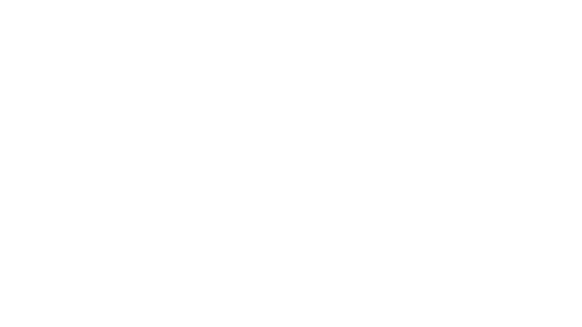
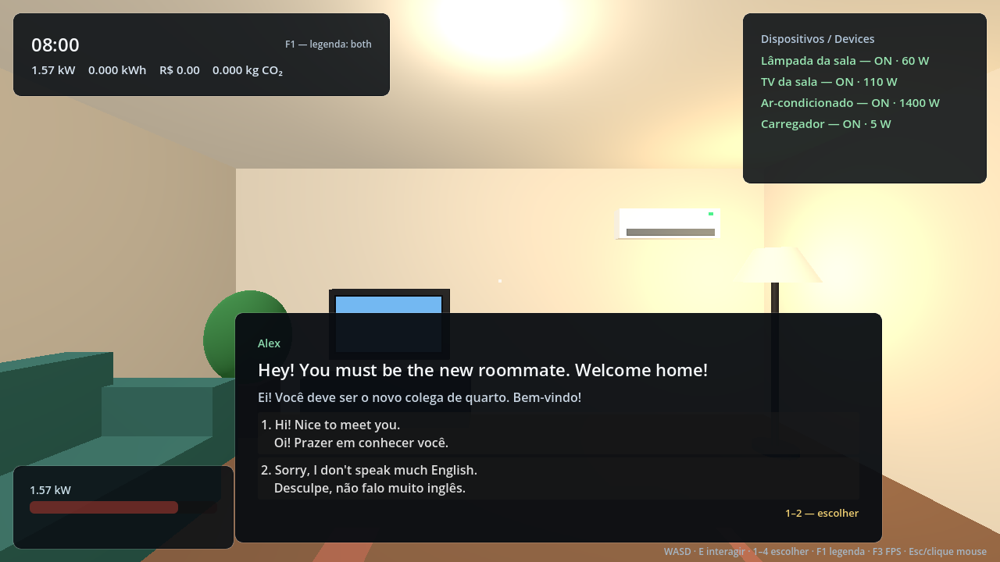
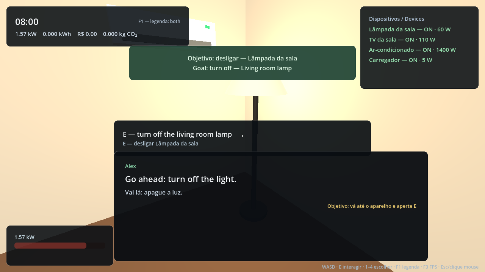
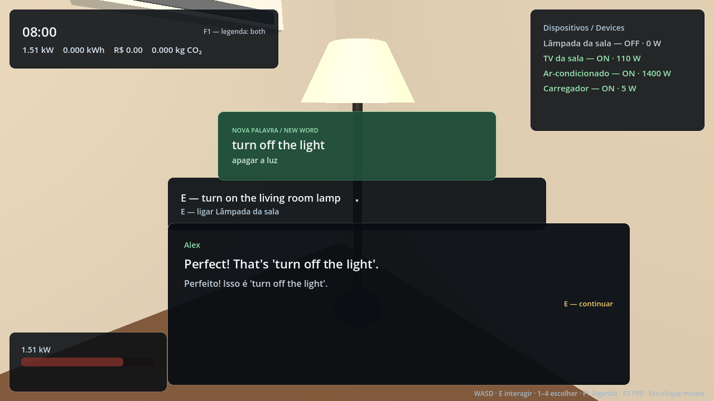
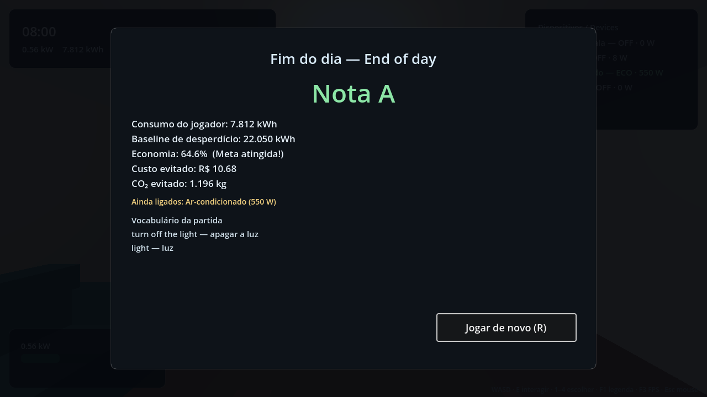

# Home Switch 🏠🇬🇧

**Serious game 3D em primeira pessoa para aprender inglês reduzindo o consumo de energia de casa.**

Você é o novo colega de quarto do Alex. Ele fala inglês, pede ajuda com a casa e só
continua a conversa quando você **faz** o que ele pediu: apagar a luz, desligar a TV,
colocar o ar-condicionado no modo eco. Cada ação muda o medidor de energia em tempo real
e rende uma palavra nova no vocabulário.

> **Status:** MVP jogável completo (Fases 1–4). Entrega final pendente de gravação do
> vídeo, ensaio presencial e publicação do release no GitHub.

[](https://github.com/omurilomota/Tutor-de-Idiomas/actions/workflows/ci.yml)
[](https://godotengine.org)
[](LICENSE)

### [▶ Jogar no navegador](https://omurilomota.github.io/Tutor-de-Idiomas/)



---

## O que já funciona

- Sala de estar 3D low-poly (~6 × 5 m), jogável em primeira pessoa no navegador.
- 4 dispositivos interativos: lâmpada, TV, ar-condicionado e carregador.
- 4 árvores de diálogo encadeadas, com 9 objetivos físicos e **32 palavras/frases** no glossário.
- O diálogo **trava no objetivo** até a ação certa; ação errada não avança.
- HUD ao vivo: relógio 08:00–22:00, kW, kWh, R$, CO₂ e estado de cada dispositivo.
- Relatório final com baseline calculado, economia, custo/CO₂ evitados, nota A–D e reinício.
- Legenda EN+PT / EN / PT (F1), overlay de FPS (F3) e atalho de debug para encerrar o dia (F4).
- **227 verificações automatizadas** headless no CI (diálogo, energia, fluxo, cenas, partida, UI e input).
- Build web sem threads + export Linux e Windows prontos em `export_presets.cfg`.

| Início | Objetivo | Vocabulário | Relatório |
|---|---|---|---|
|  |  |  |  |

## Stack

| Camada | Tecnologia |
|---|---|
| Engine | Godot 4.6.3 (Compatibility / GLES3) |
| Lógica | GDScript |
| Conteúdo | JSON (diálogos, dispositivos, configuração) |
| Testes | Runner headless próprio + GitHub Actions |
| Deploy | GitHub Pages (export Web) |

## Como rodar

```bash
# 1. Instale o Godot 4.6.3 (binário oficial ou Flatpak)
#    https://godotengine.org/download

# 2. Abra o projeto
godot --path .

# 3. Rode os testes
godot --headless --path . --import
godot --headless --path . --script testes/run_tests.gd

# 4. Gere o build web
godot --headless --path . --export-release "Web" build/web/index.html

# 5. (Opcional) Builds desktop
godot --headless --path . --export-release "Linux" build/linux/home-switch.x86_64
godot --headless --path . --export-release "Windows Desktop" build/windows/home-switch.exe
```

Saída esperada dos testes: `Verificações: 227 | Falhas: 0` e `OK`.
Detalhes de instalação, export e problemas comuns: [`docs/08-COMO-RODAR.md`](docs/08-COMO-RODAR.md).

## Controles

| Tecla | Ação |
|---|---|
| `W A S D` | andar |
| Mouse | olhar |
| `E` | interagir / avançar diálogo |
| `1`–`4` | escolher resposta |
| `F1` | alternar legenda (EN+PT / EN / PT) |
| `F3` | mostrar/ocultar FPS |
| `F4` | encerrar o dia (debug de apresentação) |
| `Esc` / clique | liberar/recapturar o mouse (no navegador o clique é necessário) |

## Estrutura

```
cenas/      cenas 3D e UI (SalaEstar, Player, HUD, CaixaDialogo, Cartao, TelaRelatorio, Main)
assets/     modelos, texturas, áudio e licenças (Gian)
dialogos/   4 árvores de diálogo em JSON + schema
dados/      dispositivos, tarifa, baseline
scripts/    autoloads, diálogo, energia, player, UI e orquestração da partida
testes/     runner headless + 7 suítes de teste
tools/      benchmark de FPS
docs/       escopo, GDD, arquitetura, energia, cronograma, QA, slides e roteiro do vídeo
```

## Documentação

| Documento | Assunto |
|---|---|
| [00 — Escopo](docs/00-ESCOPO.md) | problema, objetivos, dentro/fora, critérios de aceite |
| [01 — GDD](docs/01-GDD.md) | loop, sala, dispositivos, NPC, progressão |
| [02 — Arquitetura](docs/02-ARQUITETURA.md) | autoloads, sinais, contrato de cenas |
| [03 — Diálogos](docs/03-DIALOGOS.md) | formato JSON e como escrever sem programar |
| [04 — Energia](docs/04-ENERGIA.md) | fórmulas, baseline, relatório e balanceamento |
| [05 — Cronograma](docs/05-CRONOGRAMA.md) | fases, gates e riscos |
| [06 — Divisão de trabalho](docs/06-DIVISAO-TRABALHO.md) | donos, branches, rituais |
| [07 — Assets e licenças](docs/07-ASSETS-E-LICENCAS.md) | política CC0 e créditos |
| [08 — Como rodar](docs/08-COMO-RODAR.md) | instalação, export, CI |
| [09 — Relatório da banca](docs/09-RELATORIO-BANCA.md) | temas, decisões, limitações |
| [10 — Acessibilidade](docs/10-ACESSIBILIDADE.md) | contraste, fonte, teclado, legenda |
| [11 — Slides e ensaio](docs/11-SLIDES-E-ENSAIO.md) | 9 slides e roteiro de 5 min |
| [12 — Roteiro do vídeo](docs/12-ROTEIRO-VIDEO.md) | demo de 3 min, shot list e gravação |
| [13 — Checklist de QA](docs/13-CHECKLIST-QA.md) | 22 casos e resultado da verificação |
| [Release v1.0](docs/RELEASE-v1.0.md) | notas, checksums e checklist de publicação |

## Equipe

| Pessoa | Área |
|---|---|
| Gian | cenas 3D, arte e performance |
| Matheus | diálogos, conteúdo e lógica de interação |
| Terceiro | energia, dados, HUD, testes e qualidade |
| Murilo | coordenação, documentação e apresentação |

## Créditos

Toda a geometria é low-poly procedural feita no próprio projeto (sem asset externo),
os textos são autorais e a fonte é a padrão do Godot (OFL). Detalhes em
[`assets/LICENCAS/CREDITOS.md`](assets/LICENCAS/CREDITOS.md).

## Licença

Código sob MIT ([`LICENSE`](LICENSE)).
